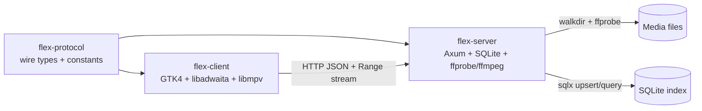

# Flex Architecture

This document describes how Flex is put together: the components, the two main
data flows (scanning and playback), the SQLite schema, the HTTP surface, and the
key design decisions and their tradeoffs.

## Components

Flex is a Cargo workspace with three crates. `flex-protocol` is deliberately
transport-agnostic and dependency-light so it can be shared by both binaries.

```
                         ┌──────────────────────────────┐
                         │        flex-protocol         │
                         │  serde wire types + consts   │
                         │  (API source of truth)       │
                         └──────────────┬───────────────┘
                                        │ depends on
                 ┌──────────────────────┴──────────────────────┐
                 │                                             │
     ┌───────────▼────────────┐                   ┌────────────▼─────────────┐
     │      flex-server       │                   │       flex-client        │
     │  Axum 0.8 REST + Range │◄── HTTP/JSON ─────│  GTK4 + libadwaita UI    │
     │  SQLite (sqlx)         │   + byte stream   │  libmpv playback         │
     │  ffprobe / ffmpeg      │                   │  reqwest client          │
     └───────────┬────────────┘                   └──────────────────────────┘
                 │
        ┌────────┴────────┐
        │  media files on │
        │  the filesystem │
        └─────────────────┘
```



| Crate            | Type      | Responsibilities                                                              |
|------------------|-----------|-------------------------------------------------------------------------------|
| `flex-protocol`  | library   | Serde types (`MediaItem`, `Library`, `Page<T>`, …) and API path constants.     |
| `flex-server`    | binary    | Config loading, directory scanning, `ffprobe` parsing, SQLite persistence, REST API, Range streaming, subtitle extraction. |
| `flex-client`    | binary    | GTK4/libadwaita UI, REST consumption, mpv embedding / external fallback.       |

## Data flow

### Scan pipeline

The scan pipeline runs on startup (`--scan-on-start`), on demand via
`POST /api/v1/scan`, and when libraries are registered from the CLI.

```
config libraries ─┐
                  │
        walkdir ──┤  for each file with a configured extension
                  │
                ffprobe (JSON output, bounded parallelism)
                  │
          parse container / video / audio / subtitle streams
                  │
           upsert row into `media_items`
                  │
          prune rows whose files disappeared
                  │
             ScanReport { libraries, scanned, added, updated, removed, errors }
```

- **Traversal.** `walkdir` visits each configured library root. Only files whose
  extension is in the configured `extensions` list are considered.
- **Probing.** Each candidate is probed with `ffprobe -print_format json`. The
  probe is synchronous and blocking, so it runs on a bounded pool
  (`spawn_blocking`) to avoid exhausting threads on large libraries.
- **Parsing.** The JSON is mapped into `VideoStream`, `AudioStream`,
  `SubtitleStream` and container/duration fields from `flex-protocol`.
- **Persistence.** Rows are upserted keyed by absolute `file_path`. Items whose
  files are no longer present are removed. Per-file errors are collected into
  `ScanReport.errors` rather than aborting the whole scan.

### Playback pipeline

```
flex-client UI
   │  GET /api/v1/items            (browse / filter)
   │  GET /api/v1/items/{id}       (metadata)
   ▼
flex-server (Axum)
   │  file path from `media_items`
   │  open file, seek to offset, stream chunk
   ▼
HTTP 206 Partial Content (Content-Range, Accept-Ranges: bytes)
   │
   ▼
libmpv (embedded in the GTK window, or external mpv fallback)
```

- The client resolves an item's stream URL from the API (`/items/{id}/stream`)
  and hands it to mpv. mpv issues `Range` requests as it seeks.
- The server never transcodes: it serves the original bytes with the correct
  `Content-Type` and byte-range semantics.
- Embedded subtitles are extracted lazily by `ffmpeg` and served as WebVTT from
  `GET /api/v1/items/{id}/subtitles/{track}`.

## Database schema

The index is a single SQLite database (path from the server config, default
`./data/flex.db`). The schema is created by the `sqlx` migration
[`crates/flex-server/migrations/0001_init.sql`](../crates/flex-server/migrations/0001_init.sql):

```sql
CREATE TABLE IF NOT EXISTS libraries (
    id         INTEGER PRIMARY KEY AUTOINCREMENT,
    name       TEXT    NOT NULL,
    path       TEXT    NOT NULL UNIQUE,
    kind       TEXT    NOT NULL,           -- movies | tv | music | other
    created_at INTEGER NOT NULL            -- unix seconds
);

CREATE TABLE IF NOT EXISTS media_items (
    id            INTEGER PRIMARY KEY AUTOINCREMENT,
    library_id    INTEGER NOT NULL REFERENCES libraries (id) ON DELETE CASCADE,
    kind          TEXT    NOT NULL,        -- movie | episode | other
    title         TEXT    NOT NULL,
    sort_title    TEXT    NOT NULL,        -- normalised for sorting
    year          INTEGER,
    overview      TEXT,
    file_path     TEXT    NOT NULL UNIQUE, -- absolute server-local path
    file_size     INTEGER NOT NULL DEFAULT 0,
    container     TEXT,
    duration_ms   INTEGER,
    video_json    TEXT,                    -- JSON: VideoStream
    audio_json    TEXT    NOT NULL DEFAULT '[]',  -- JSON: [AudioStream]
    subs_json     TEXT    NOT NULL DEFAULT '[]',  -- JSON: [SubtitleStream]
    sidecars_json TEXT    NOT NULL DEFAULT '[]',  -- JSON: [sidecar subtitles]
    poster_path   TEXT,
    backdrop_path TEXT,
    added_at      INTEGER NOT NULL,
    updated_at    INTEGER NOT NULL
);

CREATE INDEX IF NOT EXISTS idx_media_items_library    ON media_items (library_id);
CREATE INDEX IF NOT EXISTS idx_media_items_sort_title ON media_items (sort_title);
CREATE INDEX IF NOT EXISTS idx_media_items_kind       ON media_items (kind);
```

The nested video/audio/subtitle structures are stored as JSON text in single
columns rather than normalised child tables. `sqlx`/`serde_json` serialise them
directly from the shared `flex-protocol` types, so there is one schema for the
wire format and for storage. `poster_path`/`backdrop_path` hold server-local
image paths, which the API surfaces as `poster_url`/`backdrop_url`.

## API surface

Full details and payload examples are in [`API.md`](API.md).

| Method | Path                                      | Purpose                                   |
|--------|-------------------------------------------|-------------------------------------------|
| GET    | `/api/v1/health`                          | Liveness probe + version.                 |
| GET    | `/api/v1/libraries`                       | List configured libraries.                |
| POST   | `/api/v1/scan`                            | Walk all libraries and upsert items.      |
| GET    | `/api/v1/items`                           | Browse/filter items (paginated `Page<T>`).|
| GET    | `/api/v1/items/{id}`                      | Single item metadata.                      |
| GET    | `/api/v1/items/{id}/stream`               | Range-capable byte stream.                 |
| GET    | `/api/v1/items/{id}/artwork?type=…`       | Poster/backdrop image bytes.               |
| GET    | `/api/v1/items/{id}/subtitles`            | List subtitle tracks.                      |
| GET    | `/api/v1/items/{id}/subtitles/{track}`    | Extracted WebVTT subtitle track.           |

## Key design decisions & tradeoffs

- **Synchronous `ffprobe` with bounded parallelism.** `ffprobe` is a blocking
  process, not a library. Running it on a bounded `spawn_blocking` pool keeps
  scans fast without spawning one OS thread per file (which would collapse on
  large libraries). Tradeoff: scan throughput is capped by the pool size, and
  cancellation mid-scan is coarse.

- **JSON columns instead of normalised child tables.** Video/audio/subtitle
  streams are stored as JSON blobs. This keeps the schema tiny, makes the
  `flex-protocol` types the single source of truth, and avoids join-heavy
  reads. Tradeoff: you cannot cheaply index or SQL-query individual stream
  attributes (e.g. "all HEVC files") without scanning the JSON.

- **No transcoding; original bytes over Range.** The server is a file server
  with metadata. It supports `206 Partial Content` so clients seek natively.
  Tradeoff: playback compatibility depends entirely on the client/codecs; there
  is no adaptive bitrate or format conversion (see roadmap).

- **Window-id (wid) embedding on Linux.** The client passes the X11 window id
  of a GTK widget to mpv via the `wid` option, which works under XWayland.
  Tradeoff: on pure Wayland sessions there is no compositor-provided wid, so
  the client falls back to launching an external `mpv` process instead of
  embedding.

- **No authentication yet; bind to the LAN.** `flex-server` ships without auth,
  so the example config binds `0.0.0.0` for trusted home networks. Tradeoff:
  **do not expose it to the public internet** until the auth roadmap item
  lands. There is no user model, so all clients share the same index.

- **`flex-protocol` as the API contract.** Route constants and payload types
  are defined once and shared, so server and client cannot drift on the wire
  format. Tradeoff: changing a type is a breaking change felt by both crates
  at compile time (intended).
