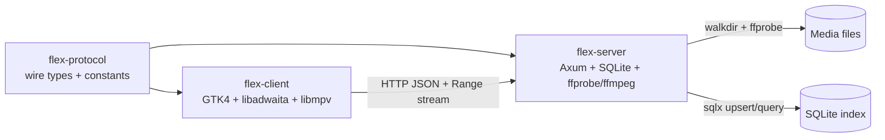
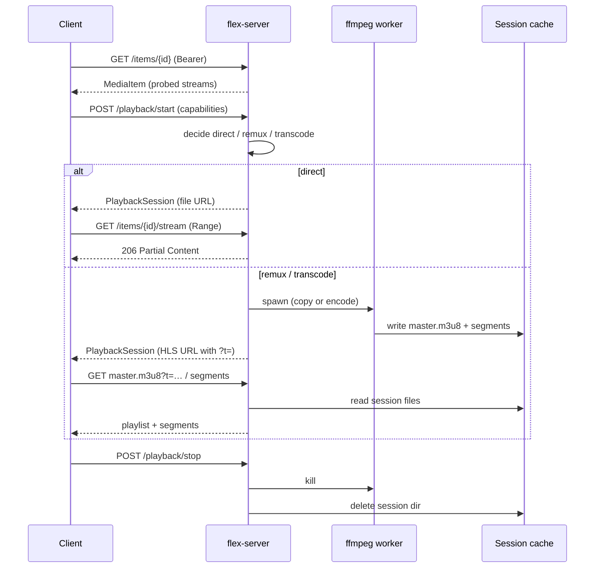

# Flex Architecture

This document describes how Flex is put together: the components, the main
data flows (authentication, scanning and playback/transcode), the SQLite
schema, the HTTP surface, and the key design decisions and their tradeoffs.

## Components

Flex is a Cargo workspace with three crates. `flex-protocol` is deliberately
transport-agnostic and dependency-light so it can be shared by both binaries.

```
                         ┌──────────────────────────────┐
                         │        flex-protocol         │
                         │  serde wire types + consts   │
                         │  (API source of truth)       │
                         └──────────────┬───────────────┘
                                        │ depends on
                 ┌──────────────────────┴──────────────────────┐
                 │                                             │
     ┌───────────▼────────────┐                   ┌────────────▼─────────────┐
     │      flex-server       │                   │       flex-client        │
     │  Axum 0.8 REST + Range │◄── HTTP/JSON ─────│  GTK4 + libadwaita UI    │
     │  SQLite (sqlx)         │   + byte stream   │  libmpv playback         │
     │  ffprobe / ffmpeg      │                   │  reqwest client          │
     └───────────┬────────────┘                   └──────────────────────────┘
                 │
        ┌────────┴────────┐
        │  media files on │
        │  the filesystem │
        └─────────────────┘
```



| Crate            | Type      | Responsibilities                                                              |
|------------------|-----------|-------------------------------------------------------------------------------|
| `flex-protocol`  | library   | Serde types (`MediaItem`, `Library`, `User`, `PlaybackSession`, …) and API path constants. |
| `flex-server`    | binary    | Config loading, auth (Argon2id + device tokens), directory scanning, `ffprobe` parsing, SQLite persistence, REST API, Range streaming, HLS remux/transcode, subtitle extraction. |
| `flex-client`    | binary    | GTK4/libadwaita UI, REST consumption, mpv embedding / external fallback.       |

Outside the workspace, `android/` holds a first-pass Android client scaffold
(unverified, not compiled) that consumes the same HTTP API — see
[`ANDROID.md`](ANDROID.md).

## Data flow

### Scan pipeline

The scan pipeline runs on startup (`--scan-on-start`), on demand via
`POST /api/v1/scan`, and when libraries are registered from the CLI.

```
config libraries ─┐
                  │
        walkdir ──┤  for each file with a configured extension
                  │
                ffprobe (JSON output, bounded parallelism)
                  │
          parse container / video / audio / subtitle streams
                  │
           upsert row into `media_items`
                  │
          prune rows whose files disappeared
                  │
             ScanReport { libraries, scanned, added, updated, removed, errors }
```

- **Traversal.** `walkdir` visits each configured library root. Only files whose
  extension is in the configured `extensions` list are considered.
- **Probing.** Each candidate is probed with `ffprobe -print_format json`. The
  probe is synchronous and blocking, so it runs on a bounded pool
  (`spawn_blocking`) to avoid exhausting threads on large libraries.
- **Parsing.** The JSON is mapped into `VideoStream`, `AudioStream`,
  `SubtitleStream` and container/duration fields from `flex-protocol`.
- **Persistence.** Rows are upserted keyed by absolute `file_path`. Items whose
  files are no longer present are removed. Per-file errors are collected into
  `ScanReport.errors` rather than aborting the whole scan.

### Authentication flow

Every request except `GET /api/v1/health` and `POST /api/v1/auth/login` passes
through auth middleware before reaching a handler:

```
POST /api/v1/auth/login {username, password, device_name?}
   │
   ▼
auth handler
   │  look up user by username
   │  verify Argon2id(password, user.password_hash)     (rate limited on failure)
   │  generate opaque random token
   │  INSERT devices (user_id, name, sha256(token), expires_at = now + 90d)
   ▼
LoginResponse { token, user, expires_at }   ── client persists token ──▶

subsequent request
   Authorization: Bearer <token>
   │
   ▼
auth middleware
   │  sha256(token) ──▶ SELECT … FROM devices JOIN users
   │  reject if absent, expired, or user deleted      → 401
   │  update devices.last_seen_at
   │  inject AuthenticatedUser { id, role } into request extensions
   ▼
handler  (admin routes additionally require role == 'admin')
```

- Tokens are validated by hashing the submitted value and matching the stored
  digest, in constant time; the raw token is never persisted.
- `POST /auth/logout` deletes the current device row;
  `DELETE /auth/devices/{id}` deletes another row owned by the same user.
- Handlers for **streams, artwork and subtitles** run behind this middleware, so
  authorisation is per user rather than per server. See
  [`SECURITY.md`](SECURITY.md) for the threat model.

### Playback & transcode pipeline

The old model ("always serve the original bytes") is now the *direct play* fast
path. Playback starts with a capability negotiation:

```
flex-client / Android
   │  GET  /api/v1/items[/{id}]                (browse + metadata)
   │  POST /api/v1/playback/start {item_id, capabilities, tracks?}
   ▼
flex-server (Axum)  ── decide ──────────────────────────────────────────────
   │  compare client capabilities vs item's probed streams:
   │    container + codecs supported? ──────────▶ DIRECT
   │    codecs ok, container/audio not? ────────▶ REMUX
   │    video codec/profile/res/bitrate unsupported? ─▶ TRANSCODE
   │
   ├─ DIRECT:   PlaybackSession { stream_kind: file,
   │              url: /api/v1/items/{id}/stream }
   │            → file opened, seeked, streamed as 206 Partial Content
   │
   ├─ REMUX:    spawn ffmpeg (-c:v copy, container/audio remux) ─┐
   └─ TRANSCODE: spawn ffmpeg (NVENC, else libx264) ─────────────┤
                                                                 ▼
                    HLS session dir: master.m3u8 + init + segments
                    PlaybackSession { stream_kind: hls,
                      url: /api/v1/playback/{id}/master.m3u8?t=<session_token> }
   │
   ▼
client HLS player fetches playlist + segments with the scoped ?t= token
   │  GET /api/v1/playback/{session_id}/{file}?t=…   (404 if unknown/expired)
   ▼
POST /api/v1/playback/stop  → kill ffmpeg, delete session dir
```



- **Direct** is I/O-bound and byte-for-byte; the server never re-encodes.
- **Remux/transcode** run `ffmpeg` as a child process writing to a per-session
  cache directory. Hardware acceleration is chosen at startup by probing
  `ffmpeg -hwaccels` / `ffmpeg -encoders` and preferring NVENC, with `libx264`
  as the software fallback.
- HLS requests are authorised by the **scoped `?t=` session token**, not the
  bearer token, so plain HLS players work without custom headers. The token
  authorises only that session.
- Full detail: [`TRANSCODING.md`](TRANSCODING.md).

## Database schema

The index is a single SQLite database (path from the server config, default
`./data/flex.db`). The schema is created by the `sqlx` migration
[`crates/flex-server/migrations/0001_init.sql`](../crates/flex-server/migrations/0001_init.sql):

```sql
CREATE TABLE IF NOT EXISTS libraries (
    id         INTEGER PRIMARY KEY AUTOINCREMENT,
    name       TEXT    NOT NULL,
    path       TEXT    NOT NULL UNIQUE,
    kind       TEXT    NOT NULL,           -- movies | tv | music | other
    created_at INTEGER NOT NULL            -- unix seconds
);

CREATE TABLE IF NOT EXISTS media_items (
    id            INTEGER PRIMARY KEY AUTOINCREMENT,
    library_id    INTEGER NOT NULL REFERENCES libraries (id) ON DELETE CASCADE,
    kind          TEXT    NOT NULL,        -- movie | episode | other
    title         TEXT    NOT NULL,
    sort_title    TEXT    NOT NULL,        -- normalised for sorting
    year          INTEGER,
    overview      TEXT,
    file_path     TEXT    NOT NULL UNIQUE, -- absolute server-local path
    file_size     INTEGER NOT NULL DEFAULT 0,
    container     TEXT,
    duration_ms   INTEGER,
    video_json    TEXT,                    -- JSON: VideoStream
    audio_json    TEXT    NOT NULL DEFAULT '[]',  -- JSON: [AudioStream]
    subs_json     TEXT    NOT NULL DEFAULT '[]',  -- JSON: [SubtitleStream]
    sidecars_json TEXT    NOT NULL DEFAULT '[]',  -- JSON: [sidecar subtitles]
    poster_path   TEXT,
    backdrop_path TEXT,
    added_at      INTEGER NOT NULL,
    updated_at    INTEGER NOT NULL
);

CREATE INDEX IF NOT EXISTS idx_media_items_library    ON media_items (library_id);
CREATE INDEX IF NOT EXISTS idx_media_items_sort_title ON media_items (sort_title);
CREATE INDEX IF NOT EXISTS idx_media_items_kind       ON media_items (kind);
```

Authentication adds two tables, applied by the migration
[`crates/flex-server/migrations/0002_auth.sql`](../crates/flex-server/migrations/0002_auth.sql).
Passwords are stored as **Argon2id** PHC strings; bearer tokens are stored only
as their **SHA-256** digest, so neither table yields a usable credential if the
database leaks:

```sql
CREATE TABLE IF NOT EXISTS users (
    id            INTEGER PRIMARY KEY AUTOINCREMENT,
    username      TEXT    NOT NULL UNIQUE,
    password_hash TEXT    NOT NULL,                 -- Argon2id PHC string
    role          TEXT    NOT NULL DEFAULT 'user',  -- 'admin' | 'user'
    created_at    INTEGER NOT NULL                  -- unix seconds
);

-- One row per issued device token (per login / per device).
CREATE TABLE IF NOT EXISTS devices (
    id           INTEGER PRIMARY KEY AUTOINCREMENT,
    user_id      INTEGER NOT NULL REFERENCES users (id) ON DELETE CASCADE,
    name         TEXT    NOT NULL,                  -- human-readable device name
    token_hash   TEXT    NOT NULL UNIQUE,           -- SHA-256 hex of the opaque token
    created_at   INTEGER NOT NULL,
    last_seen_at INTEGER,                           -- updated on use (throttled)
    expires_at   INTEGER                            -- NULL = non-expiring
);

CREATE INDEX IF NOT EXISTS idx_devices_user ON devices (user_id);
```

`users` maps to the `User` wire type; `devices` to `Device`. A token is
resolved by hashing the presented bearer value and looking up `token_hash`
(unique, so the lookup is indexed); `expires_at` and `last_seen_at` drive expiry
and revocation UIs. Deleting a user cascades to their devices.

The nested video/audio/subtitle structures are stored as JSON text in single
columns rather than normalised child tables. `sqlx`/`serde_json` serialise them
directly from the shared `flex-protocol` types, so there is one schema for the
wire format and for storage. `poster_path`/`backdrop_path` hold server-local
image paths, which the API surfaces as `poster_url`/`backdrop_url`.

## API surface

Full details and payload examples are in [`API.md`](API.md).

| Method | Path                                      | Purpose                                   |
|--------|-------------------------------------------|-------------------------------------------|
| GET    | `/api/v1/health`                          | Liveness probe + version. **No auth.**    |
| POST   | `/api/v1/auth/login`                      | Exchange credentials for a device token. **No auth.** |
| POST   | `/api/v1/auth/logout`                     | Revoke the current device token.          |
| GET    | `/api/v1/auth/me`                         | Authenticated user.                        |
| GET    | `/api/v1/auth/devices`                    | List the user's device tokens.            |
| DELETE | `/api/v1/auth/devices/{id}`               | Revoke one device token.                  |
| GET/POST | `/api/v1/auth/users`                    | Admin: list / create users.               |
| POST   | `/api/v1/playback/start`                  | Choose direct/remux/transcode; open a session. |
| POST   | `/api/v1/playback/stop`                   | Stop a session and free resources.        |
| GET    | `/api/v1/playback/{id}/master.m3u8`       | HLS master playlist (`?t=` scoped token). |
| GET    | `/api/v1/playback/{id}/{file}`            | HLS init/segment (`?t=` scoped token).    |
| GET    | `/api/v1/system/info`                     | Version, `hwaccels`, encoders, transcode flag. |
| GET    | `/api/v1/libraries`                       | List configured libraries.                |
| POST   | `/api/v1/scan`                            | Walk all libraries and upsert items.      |
| GET    | `/api/v1/items`                           | Browse/filter items (paginated `Page<T>`).|
| GET    | `/api/v1/items/{id}`                      | Single item metadata.                      |
| GET    | `/api/v1/items/{id}/stream`               | Range-capable byte stream (direct play).  |
| GET    | `/api/v1/items/{id}/artwork?type=…`       | Poster/backdrop image bytes.               |
| GET    | `/api/v1/items/{id}/subtitles`            | List subtitle tracks.                      |
| GET    | `/api/v1/items/{id}/subtitles/{track}`    | Extracted WebVTT subtitle track.           |

All routes except `/health` and `/auth/login` require a bearer token; HLS
playlist/segment routes are additionally authorised by the scoped `?t=` token.

## Key design decisions & tradeoffs

- **Synchronous `ffprobe` with bounded parallelism.** `ffprobe` is a blocking
  process, not a library. Running it on a bounded `spawn_blocking` pool keeps
  scans fast without spawning one OS thread per file (which would collapse on
  large libraries). Tradeoff: scan throughput is capped by the pool size, and
  cancellation mid-scan is coarse.

- **JSON columns instead of normalised child tables.** Video/audio/subtitle
  streams are stored as JSON blobs. This keeps the schema tiny, makes the
  `flex-protocol` types the single source of truth, and avoids join-heavy
  reads. Tradeoff: you cannot cheaply index or SQL-query individual stream
  attributes (e.g. "all HEVC files") without scanning the JSON.

- **Direct play first; transcode only as a fallback.** Original bytes over
  Range remain the default path (`206 Partial Content`), with remux and
  transcode layered on top only when the client's `ClientCapabilities` can't
  handle the source. Tradeoff: the server now depends on `ffmpeg` for
  remux/transcode and must bound concurrent encodes (a GPU/CPU DoS vector);
  direct play still depends on the client's codec support.

- **Opaque, hashed, per-device tokens with Argon2id passwords.** Passwords are
  Argon2id hashes; bearer tokens are random and stored only as SHA-256 digests,
  so a database leak yields neither. Tokens are individually revocable and
  expire (90 days by default) from the `devices` table. Tradeoff: there is no
  central SSO/OAuth — accounts are local, and every protected request pays a
  token-hash lookup (cheap, indexed). Public deployments terminate TLS at a
  reverse proxy and bind the server to loopback; see [`SECURITY.md`](SECURITY.md)
  and [`REVERSE_PROXY.md`](REVERSE_PROXY.md).

- **Window-id (wid) embedding on Linux.** The client passes the X11 window id
  of a GTK widget to mpv via the `wid` option, which works under XWayland.
  Tradeoff: on pure Wayland sessions there is no compositor-provided wid, so
  the client falls back to launching an external `mpv` process instead of
  embedding.

- **`flex-protocol` as the API contract.** Route constants and payload types
  are defined once and shared, so server and client cannot drift on the wire
  format. Tradeoff: changing a type is a breaking change felt by both crates
  at compile time (intended).
